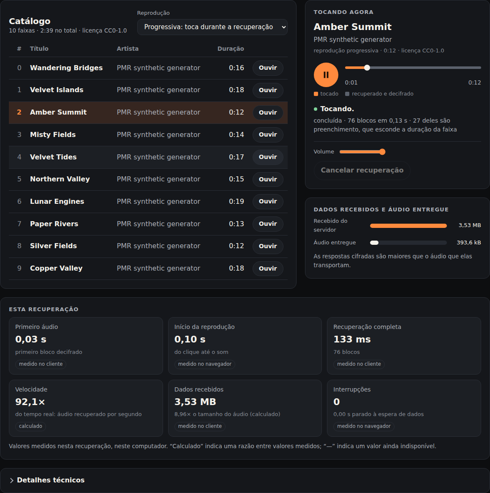

# Private music streaming with single-server HE-PIR (UNICAMP TCC prototype)

Undergraduate thesis project (Computer Engineering, UNICAMP), author Felipe Santos, supervisor
Prof. Dr. Hilder Vitor Lima Pereira. A user picks a track in a browser and hears audio reconstructed
**only from decrypted PIR responses**. The protocol is designed to hide the selected track from
an honest-but-curious database server under the default padded retrieval policy.



*Actual application capture with the synthetic mini catalog. Metrics describe this run only.*

The implementation uses single-server computational PIR with the BFV scheme (Microsoft SEAL 4.1.1
via TenSEAL 0.3.14). This is a research prototype; its assumptions and limitations are described below.

## Quick start

Run from the repository root on Linux x86_64 or WSL2 Ubuntu. The first setup needs internet access,
`curl`, `tar`, and `python3` (or `unzip` to extract the uv wheel). Tools, Python and dependencies are
installed inside the project; the scripts do not install system packages.

```bash
bash scripts/setup.sh      # local uv + CPython 3.10 + hash-pinned wheels; verifies the catalogs
bash scripts/test.sh       # standard test suite; --all includes the full-length-track test
bash scripts/demo.sh       # starts both services, retrieves a track and prints the UI URL
```

Open the printed `http://127.0.0.1:8701/?t=<token>` in a browser on the same machine. On Windows
with WSL2, use the same URL with `localhost` if needed. The token changes on every client start.
The interface uses Portuguese: "Começar a ouvir" opens the catalog and player. Stop the demo with
Ctrl-C. Both services bind only to loopback.

To start the services separately, run each command in its own terminal:

```bash
bash scripts/run_server.sh  # PIR server, 127.0.0.1:8700
bash scripts/run_client.sh  # trusted client and browser UI, 127.0.0.1:8701
```

For a remote development machine, forward the UI port with
`ssh -L 8701:127.0.0.1:8701 <user>@<host>`, then open the printed URL using `localhost`.

## Architecture and privacy

The browser communicates with a trusted local client, which holds the BFV secret key in memory.
The client sends an encrypted selection to the PIR server. For each audio block, the server
homomorphically combines the same block from every track using the encrypted selectors. Only
the client decrypts the result, removes padding and streams the recovered PCM to the browser.
The client does not read the server's audio files, and retrieval errors do not fall back to a
non-private download. Conventional downloads run as separate experimental baselines.

The default `pad` policy retrieves the same number of blocks, in the same order, for every track.
Every retrieval uses fresh encryption randomness. Default BFV parameters are polynomial degree
4096, plaintext modulus 65537 and coefficient-modulus bits 36 + 36 + 37, validated by SEAL at its
128-bit classical security level.

The privacy model has explicit limits:

- The server is honest-but-curious. Malicious replies and selective-failure attacks are outside
  the model. Functional and protocol tests are not a cryptographic security proof.
- The server sees connection and session metadata, timing, retrieval counts and cancellations.
  Ciphertext compression can cause small size variations. PIR does not provide anonymity.
- The experimental `stop` policy leaks track length through the block count and can identify
  the selected track in this catalog. It is not the default privacy policy.
- This is PIR, not symmetric PIR: it does not protect the database against a malicious client.
- The prototype uses loopback HTTP. Remote deployment, transport security and protection against
  a compromised local device are outside its scope.

## Layout

| Path | Content |
|---|---|
| `src/pmr/he/` | BFV parameters, optimized SEAL backend, didactic TenSEAL backend, serialization |
| `src/pmr/pir/` | byte packing, padded database layout, PIR engines and wire format |
| `src/pmr/server/` | loopback HTTP PIR server and process-sharded workers |
| `src/pmr/client/` | trusted client, decryption and browser UI |
| `src/pmr/conventional/` | non-private single-track and whole-database baselines |
| `src/pmr/audio/` | WAV I/O, synthetic music generator, manifests and audio import |
| `src/pmr/experiments/` | experiment runner, client worker, playback model and system information |
| `scripts/` | application setup, demo, tests, experiments and transfer packaging |
| `experiments/` | experiment plans and analysis script |
| `data/catalog/` | full, mini and smoke audio catalogs with manifests |
| `results/` | raw measurements, summaries, figures and browser/SealPIR results |
| `tests/` | pytest suite and separate browser playback tests |
| `bench/sealpir/`, `third_party/` | separate SealPIR benchmark, pinned source archives and provenance |

## Dataset and reproducibility

The included synthetic catalogs use 16 kHz, mono, signed 16-bit PCM: `full` has 10 tracks of
about 166–193 seconds, `mini` has 10 tracks of 12–20 seconds, and `smoke` has four tracks of
2–4 seconds. Each manifest records the audio length and SHA-256 of the PCM bytes, excluding
the WAV header. Keep the WAV files together with their manifests.

```bash
source ./env.sh
.venv/bin/python -m pmr.audio.dataset verify data/catalog/full
.venv/bin/python -m pmr.audio.dataset info data/catalog/full
# Optional: render a separate catalog without overwriting the supplied audio.
.venv/bin/python -m pmr.audio.dataset generate --profile mini --out data/catalog/generated/example
```

Setup verifies existing catalogs and generates missing ones. The generator is deterministic on
the development platform, but CPU or library differences may change rounding by one or two PCM
units. The shipped WAV files and manifest hashes define the reference dataset. Use `verify
--rerender` to compare with a fresh render; a mismatch must be investigated rather than silently
replacing the reference hashes. Retain `requirements.lock` for reproducible installation.

## Experiments and results

```bash
bash scripts/bench.sh e1_main   # one experiment plan
# bash scripts/bench.sh        # all five main plans, run sequentially
source ./env.sh
.venv/bin/python experiments/analyze.py results/experiments/20261121T195051Z_e1_main
```

For a new run, replace the final path with the directory printed by `bench.sh`. Analysis writes
summaries to `results/summary/` and figures to `results/figures/`; use `--out` and `--figures` to
choose separate output directories and preserve the published results.

| Plan | Purpose |
|---|---|
| `e1_main` | compare didactic and optimized PIR with conventional downloads |
| `e2_ablation` | isolate implementation and protocol choices |
| `e3_catalog` | measure scaling with the number of tracks |
| `e4_duration` | measure scaling with track duration |
| `e6_link` | emulate bandwidth-limited responses over loopback |

Main recorded results on one machine over loopback (see [E1 summary](results/summary/e1_main.csv)):

| Full catalog (10 tracks, ~3 min) | Retrieval | First audio | Received | Server CPU |
|---|---:|---:|---:|---:|
| Didactic protocol, 1 byte/slot (original, generalized) | 14.21 s | 38 ms | 133.4 MB | 14.1 s |
| Optimized, 2 bytes/slot | 1.50 s | 39 ms | 34.9 MB | 1.14 s |
| Optimized, 2 bytes/slot, expanded query | 1.48 s | 25 ms | 34.9 MB | 1.15 s |
| Conventional single-track download (not private) | ~4 ms | 0.3 ms | 5.6 MB | ~0 |

These are historical measurements, not performance guarantees. Raw runs include `client.jsonl`,
`server_stats.json`, run metadata and failure records. Warm-up retrievals are excluded from the
reported timing statistics; correctness is checked against the catalog hashes on each trial.

Retrieval time runs from query generation to decoding the last requested block. First-audio time
ends when the first decoded PCM block becomes available; it is not a browser playback measurement.
Received bytes include HTTP traffic but exclude TCP/IP headers. Server CPU includes workers and
is averaged across warm-ups and trials. Key generation, session setup and database preprocessing
are reported separately from recurring retrieval costs. Playback-model stalls and actual browser
playback are separate measurements. E6 emulates bandwidth only, without latency or packet loss.

## Validation

```bash
bash scripts/test.sh --all       # includes the full-length-track test
bash scripts/demo.sh --once      # retrieves and verifies a full track, then stops both services
```

The demo checks the recovered PCM against the catalog hash. The standard tests generate their
own auxiliary audio fixtures and do not require local legacy files.

The optional browser suite checks actual playback and has a separate environment:

```bash
bash scripts/setup.sh --with-browser-test
bash scripts/browser_test.sh
```

See [the browser test README](tests/browser/README.md) for requirements, test cases and outputs.

## Repository scope

The shared repository contains the application, setup, tests, datasets, experiments and results.
Thesis sources, internal documentation, the original legacy experiment and their dedicated helper
scripts are kept locally and excluded from version control. They are not required to run the
application or its test suite. Environments, tools, caches and transfer archives are also local.

`bash scripts/make_transfer_package.sh` creates a transferable archive under `dist/`, excluding
those local materials. It includes the catalogs and results; run setup on the destination machine
to recreate the environment.

## Published diagnostics

Experiment and browser reporters remove local workstation paths, access tokens and temporary
session handles from exported diagnostics. Hardware characteristics, package versions, code
fingerprints, timing measurements, byte counts and audio hashes remain available for comparison.
The retained historical results have the same measurements as before this metadata cleanup.
Live service ready files and environments are local artifacts and must not be published.
